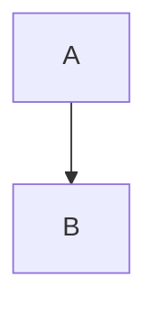

> A note above the title.

# Fixture page

The lead under the title, with `inline code`, a [link](other.md) and **bold** words.

## First section

A paragraph that says one thing.

- An item that says another
    - A nested item
- A second item <a href="x.html">with raw markup</a>.

> A quotation a reader sees.

| a | b |
|---|---|
| 1 | 2 |

```python
never_spoken = True
```



<div class="diagram"><p class="diagram-links"><a href="d.html">Open full size</a></p></div>

### Deeper heading

Text under the deeper heading.

#### Deepest heading

Text under the deepest heading, spoken inside the third-level section.

## Second section

Last words with a literal <angle> bracket.
